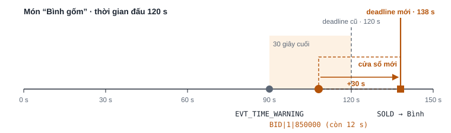
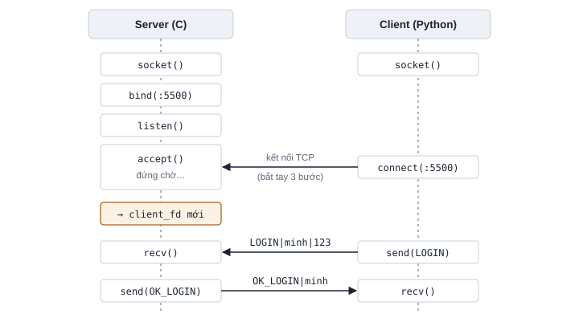
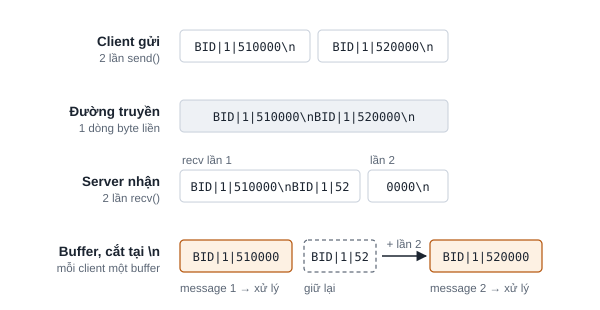
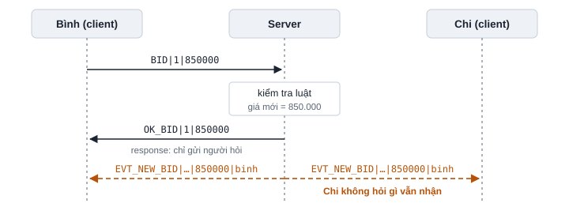
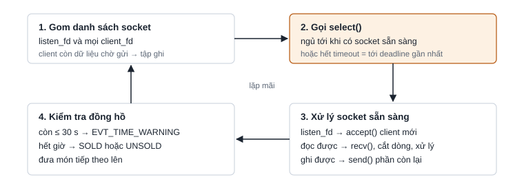

# Kiến thức nền cho dự án Online Auction

Tài liệu này giải thích những gì nằm phía sau thiết kế của nhóm: phiên đấu giá chạy thế
nào, và năm khái niệm mạng mà hệ thống dựa vào. Đọc lần lượt từ trên xuống, mất khoảng
40 phút. Cuối trang có câu hỏi tự kiểm tra và bảng từ vựng tiếng Anh để thuyết trình.

> Đây là tài liệu **giải thích**. Luật chính thức nằm ở `PROTOCOL.md` và `DATA_MODEL.md`.
> Nếu hai bên nói khác nhau thì làm theo `PROTOCOL.md` và `DATA_MODEL.md`. Sơ đồ tổng thể
> của hệ thống xem ở [`KIEN_TRUC.md`](KIEN_TRUC.md).

**Mục lục**

1. [Nghiệp vụ: một phiên đấu giá chạy thế nào](#1-nghiệp-vụ-một-phiên-đấu-giá-chạy-thế-nào)
2. [Socket TCP: server và client nối với nhau thế nào](#2-socket-tcp-server-và-client-nối-với-nhau-thế-nào)
3. [TCP là dòng byte, nên phải tự tách message](#3-tcp-là-dòng-byte-nên-phải-tự-tách-message)
4. [Giao thức ứng dụng: luật nói chuyện giữa client và server](#4-giao-thức-ứng-dụng-luật-nói-chuyện-giữa-client-và-server)
5. [select(): một luồng phục vụ nhiều client](#5-select-một-luồng-phục-vụ-nhiều-client)
6. [Vì sao client cần hai luồng](#6-vì-sao-client-cần-hai-luồng)
7. [Tự kiểm tra](#tự-kiểm-tra)
8. [Từ vựng khi thuyết trình bằng tiếng Anh](#từ-vựng-khi-thuyết-trình-bằng-tiếng-anh)

---

## 1. Nghiệp vụ: một phiên đấu giá chạy thế nào

*Nguồn: `PROTOCOL.md` mục 5–7, đề bài Topic 3 (`DE_BAI.md`).*

Hệ thống mô phỏng một **nhà đấu giá trực tiếp**. Có ba vai: **người dùng** nói chung,
**chủ phòng** (người tạo phòng đấu giá) và **người tham gia** (người vào phòng để trả giá).

- Chủ phòng tạo phòng rồi xếp các vật phẩm vào **hàng đợi**. Mỗi vật phẩm có giá khởi
  điểm, thời gian đấu, và có thể có giá mua ngay.
- Khi chủ phòng bấm bắt đầu, **mỗi lúc chỉ đấu một món**. Món đấu xong thì server tự đưa
  món tiếp theo lên, cho tới khi hết hàng đợi.
- Mỗi người chỉ ở **một phòng** tại một thời điểm.

### Trạng thái của phòng và của vật phẩm

| Đối tượng | Các trạng thái, theo thứ tự |
|---|---|
| Phòng | `WAITING` (chưa bắt đầu, còn thêm được vật phẩm) → `RUNNING` (đang đấu) → `FINISHED` (hết hàng đợi, chỉ xem kết quả) |
| Vật phẩm | `PENDING` (đang chờ) → `ACTIVE` (đang đấu) → `SOLD` (đã bán) hoặc `UNSOLD` (hết giờ mà không ai trả giá) |

### Luật đấu giá

Hệ thống dùng **đấu giá kiểu Anh** (English auction): giá chỉ đi lên, ai trả cao nhất
khi hết giờ thì thắng.

- **Mức tăng tối thiểu 10.000 VND.** Lượt trả giá hợp lệ khi giá ≥ giá hiện tại + 10.000.
  Chưa ai trả thì giá hiện tại là giá khởi điểm.
- **Không tự trả đè.** Người đang giữ giá cao nhất không được trả tiếp. Chủ phòng cũng
  không được trả giá trong phòng của mình.
- **Mua ngay.** Nếu món có giá mua ngay, bất kỳ ai (trừ chủ phòng) cũng có thể trả đúng
  giá đó để kết thúc món ngay lập tức. Trả giá bằng hoặc cao hơn giá mua ngay cũng được
  tính là mua ngay.
- **Luật 30 giây.** Khi còn 30 giây, server cảnh báo cả phòng. Có người trả giá trong
  30 giây cuối thì đồng hồ được đặt lại thành 30 giây.

Luật 30 giây để chống **sniping**, tức là chờ tới giây cuối mới trả giá để người khác
không kịp phản ứng. Với luật này, một món chỉ kết thúc khi đã có 30 giây liền không ai
muốn trả thêm.



Ở giây 90 (còn 30 giây), server gửi `EVT_TIME_WARNING` cho cả phòng. Bình trả giá ở
giây 108, lúc còn 12 giây, nên deadline mới là 108 + 30 = 138 giây và server gửi
`EVT_TIME_EXTENDED`. Sau đó không ai trả thêm, nên đến giây 138 món được bán cho Bình.

### Một phiên mẫu, kể bằng lời

1. An tạo phòng "Đồ cổ Hà Nội" với 2 món: Bình gốm (khởi điểm 500.000, mua ngay
   3.000.000) và Đồng hồ cổ (khởi điểm 200.000, mua ngay 1.000.000). An bấm bắt đầu.
2. Bình gốm lên sàn. Bình trả 505.000 thì bị từ chối, vì phải trả ít nhất 510.000. Bình
   trả lại 510.000 thì được chấp nhận, và cả phòng thấy giá mới.
3. Chi trả 550.000. Còn 30 giây, cả phòng nhận cảnh báo. Bình trả 850.000 nên đồng hồ
   được gia hạn. Không ai trả thêm, Bình thắng với giá 850.000.
4. Server tự đưa Đồng hồ cổ lên. Dũng bấm mua ngay 1.000.000, món kết thúc luôn.
5. Hết hàng đợi, phòng chuyển sang `FINISHED`.

Các message của phiên này xem ở `PROTOCOL.md` mục 12.

> **Câu cần nhớ.** Mỗi phòng có một hàng đợi vật phẩm. Mỗi lúc chỉ đấu một món, giá chỉ
> tăng, mỗi lần tăng ít nhất 10.000 VND, và trả giá trong 30 giây cuối thì đồng hồ quay
> về 30 giây.
>
> *Each room has a queue of items, auctioned one at a time. Prices only go up, by at
> least 10,000 VND, and a bid in the last 30 seconds resets the clock to 30 seconds.*

---

## 2. Socket TCP: server và client nối với nhau thế nào

*Tài liệu của thầy: Lec03 Socket APIs, Lec04 TCP, `SampleCode/TCP/echoServer.c` và
`echoClient.c`.*

**Socket** là đầu nối của một kết nối mạng mà chương trình đọc ghi được, giống như một
đầu dây điện thoại. Hai bên làm những bước khác nhau:

- **Server**: `socket()` tạo socket, `bind()` gắn vào một cổng, `listen()` bắt đầu nghe,
  rồi `accept()` chờ có người gọi tới.
- **Client**: `socket()` rồi `connect()` tới địa chỉ IP và cổng của server.
- Khi đã nối, cả hai bên dùng `send()` và `recv()` để gửi, nhận dữ liệu, và `close()` để
  đóng.



Socket tạo bằng `listen()` (gọi là `listen_fd`) chỉ dùng để nhận kết nối mới. Mỗi lần
`accept()` trả về một socket mới (`client_fd`) dành riêng cho client vừa nối vào. Server
có 50 client thì có 50 `client_fd` cộng với 1 `listen_fd`.

Vì sao dùng TCP mà không dùng UDP? UDP có thể làm mất gói tin hoặc đảo thứ tự. Với đấu
giá, mất một gói `BID` hay hai lượt trả giá bị đảo thứ tự đều làm sai người thắng. TCP
đảm bảo dữ liệu đến **đủ và đúng thứ tự**.

> **Câu cần nhớ.** Server có một socket để nghe, và mỗi client được một socket riêng do
> `accept()` trả về. Nhóm dùng TCP vì cần dữ liệu đến đủ và đúng thứ tự.
>
> *The server has one listening socket, and accept() gives every client its own socket.
> We use TCP because bids must arrive complete and in order.*

---

## 3. TCP là dòng byte, nên phải tự tách message

*Tài liệu của thầy: Lec03 (bảng Stream so với Datagram, phần recv/send), slide
Application-protocol mục "TCP Framing". Của nhóm: `PROTOCOL.md` mục 1.*

Đây là ý **quan trọng nhất** của môn và thầy rất hay hỏi. TCP chuyển một **dòng byte
liên tục** và **không giữ ranh giới** giữa các lần gửi. Client gọi `send()` hai lần,
nhưng server có thể nhận cả hai trong một lần `recv()`, hoặc nhận một message bị cắt làm
đôi.



Cách chia byte như trong hình chỉ là một khả năng. Lần chạy khác có thể nhận cả hai
message trong một lần `recv()`, hoặc mỗi lần chỉ được vài byte. Chương trình phải đúng
trong mọi trường hợp.

Có ba cách phổ biến để biết một message kết thúc ở đâu:

| Cách | Ví dụ | Khi nào hợp |
|---|---|---|
| Độ dài cố định | Tic-Tac-Toe trong slide của thầy: 1 byte loại message + payload cố định | Message ngắn, luôn cùng kích thước |
| Gửi độ dài trước | 4 byte độ dài, sau đó là nội dung | Dữ liệu nhị phân như file, ảnh |
| **Ký tự kết thúc (OAP chọn cách này)** | Mỗi message kết thúc bằng `\n` | Message dạng text, độ dài thay đổi, dễ thử bằng `nc` |

Vì OAP dùng `|` để ngăn trường và `\n` để kết thúc message, nếu dữ liệu người dùng nhập
có chứa hai ký tự này thì phải **escape**. Ví dụ tên vật phẩm `Bình|gốm` được gửi thành
`Bình\pgốm`, bên nhận đổi ngược lại. Tương tự, `\` thành `\\` và xuống dòng thành `\n`.

`send()` cũng có thể gửi thiếu: gọi gửi 100 byte nhưng hệ điều hành mới nhận 60. Phía
client Python dùng `sendall()` để tự gửi nốt. Phía server giữ phần còn lại trong **send
buffer** và gửi tiếp ở vòng lặp sau (xem phần 5).

> **Câu cần nhớ.** TCP không giữ ranh giới message. Mỗi bên giữ một buffer, nối dữ liệu
> vừa nhận vào cuối, cắt ra từng message tại `\n`, phần chưa đủ thì giữ lại chờ lần nhận
> sau.
>
> *TCP has no message boundaries. Each side keeps a buffer, appends what it receives,
> cuts messages at the newline and keeps the incomplete rest for the next recv().*

---

## 4. Giao thức ứng dụng: luật nói chuyện giữa client và server

*Tài liệu của thầy: slide Application-protocol (ví dụ Tic-Tac-Toe). Của nhóm:
`PROTOCOL.md`.*

TCP chỉ chuyển byte. **Giao thức ứng dụng** là phần nhóm tự quy định: message trông thế
nào, gửi theo thứ tự nào, sai thì báo lỗi ra sao. HTTP hay SMTP cũng là giao thức ứng
dụng chạy trên TCP. Giao thức của nhóm tên là **OAP** (Online Auction Protocol).

OAP có ba loại message:

- **Request**: client gửi lên, ví dụ `BID|1|850000` là trả 850.000 cho món số 1. Ghi rõ
  số món để lệnh trả giá đến muộn không bị tính nhầm sang món sau. Mỗi request nhận đúng
  một response.
- **Response**: server trả lời người vừa hỏi. Thành công thì bắt đầu bằng `OK_`, thất
  bại thì là `ERR|mã lỗi|lời nhắn`, ví dụ `ERR|E_BID_TOO_LOW|Minimum bid is 510000`.
- **Event**: server **tự đẩy** xuống, không ai hỏi, ví dụ `EVT_NEW_BID` khi có người trả
  giá.

Event là chỗ khác lớn nhất so với Tic-Tac-Toe. Trong game theo lượt, người chơi đi rồi
chờ đối thủ. Trong đấu giá, giá thay đổi vì **người khác** trả giá, nên server phải chủ
động báo cho tất cả mọi người.



Response chỉ đến tay người gửi request. Event được gửi cho mọi thành viên trong phòng, kể
cả người vừa trả giá.

Server còn phải **nhớ trạng thái** của từng client: đã đăng nhập chưa, đang ở phòng nào.
Nhờ đó server trả được các lỗi như `E_AUTH` (chưa đăng nhập mà đã gửi lệnh khác) hay
`E_NOT_IN_ROOM` (trả giá khi chưa vào phòng).

> **Câu cần nhớ.** Request luôn nhận đúng một response. Event do server tự đẩy cho cả
> phòng, vì giá thay đổi do người khác trả.
>
> *Every request gets exactly one response. Events are pushed by the server to the whole
> room, because prices change when other people bid.*

---

## 5. select(): một luồng phục vụ nhiều client

*Tài liệu của thầy: Lec04 TCP chỉ nhắc một dòng "Multiplexing server: use select", phần
này giải thích kỹ hơn.*

**Vấn đề:** `accept()` và `recv()` là lệnh **chặn** (blocking). Nếu server gọi `recv()`
trên socket của An, server sẽ đứng chờ An. Trong lúc đó Bình gửi `BID` mà không có ai
đọc.

Có ba cách giải quyết:

| Cách | Ý tưởng | Ví von quán ăn |
|---|---|---|
| Mỗi client một thread hoặc process | Mỗi luồng chặn ở `recv()` của riêng một client | Mỗi bàn có một người phục vụ riêng |
| **`select()` (nhóm chọn)** | Hỏi hệ điều hành trong các socket này cái nào đã có dữ liệu, rồi chỉ xử lý những cái đó | Một người phục vụ đứng giữa quán, bàn nào giơ tay thì tới bàn đó |
| `poll()`, `epoll()` | Giống `select()` nhưng chịu được nhiều kết nối hơn | Ngoài phạm vi môn học |



Mẹo hẹn giờ: timeout của `select()` được đặt bằng thời gian còn lại tới deadline gần
nhất. Không có ai gửi gì thì server vẫn tự thức dậy đúng lúc phải cảnh báo hoặc đóng món,
nên không cần luồng hẹn giờ riêng.

Viết bằng mã giả kiểu C:

```c
for (;;) {
    FD_ZERO(&rfds); FD_ZERO(&wfds);
    FD_SET(listen_fd, &rfds);
    for (mỗi client c) {
        FD_SET(c->fd, &rfds);
        if (c->out_len > 0) FD_SET(c->fd, &wfds);   /* còn dữ liệu chờ gửi */
    }
    tv = thời gian tới deadline gần nhất;
    select(maxfd + 1, &rfds, &wfds, NULL, &tv);    /* chặn ở đây */

    if (FD_ISSET(listen_fd, &rfds)) accept client mới;
    for (mỗi client c) {
        if (FD_ISSET(c->fd, &rfds)) recv vào c->in, xử lý từng dòng đủ;
        if (FD_ISSET(c->fd, &wfds)) send tiếp c->out;
    }
    kiểm tra deadline của các phòng;   /* cảnh báo 30 s, đóng món */
}
```

**Vì sao hợp với đấu giá:** mọi client cùng đọc và sửa dữ liệu của một phòng. Chỉ có một
luồng nên các lượt `BID` luôn được xử lý lần lượt, không bao giờ có hai lượt cùng sửa giá
một lúc (race condition), và không cần mutex. Giới hạn của `select()` là khoảng 1024
socket (`FD_SETSIZE`), dư cho bài tập lớn.

> **Câu cần nhớ.** `select()` cho một luồng chờ nhiều socket cùng lúc và chỉ xử lý những
> socket đã sẵn sàng. Chỉ có một luồng nên không có race condition giữa các lượt trả giá,
> và timeout của `select()` dùng luôn làm đồng hồ đấu giá.
>
> *select() lets one thread wait on many sockets and handle only the ready ones. With one
> thread there are no race conditions between bids, and the select() timeout doubles as
> the auction clock.*

---

## 6. Vì sao client cần hai luồng

*Xem thêm sơ đồ trong [`KIEN_TRUC.md`](KIEN_TRUC.md).*

- Giao diện phải **luôn phản hồi**. Nếu luồng GUI gọi `recv()` và bị chặn, cửa sổ bị
  treo, bấm nút không được.
- Event có thể đến **bất cứ lúc nào**, kể cả khi người dùng không bấm gì. Vì vậy cần một
  luồng riêng lúc nào cũng ngồi chờ ở `recv()`.
- Trong Qt, chỉ luồng GUI được sửa giao diện. Luồng mạng nhận được message thì phát
  **Signal**, Qt chuyển message đó sang luồng GUI một cách an toàn.

Luồng mạng cũng làm framing giống hệt server: nối byte vào buffer và cắt tại `\n`.

```python
class NetThread(QThread):
    message = Signal(str)                  # gửi sang luồng GUI

    def run(self):
        buf = b""
        while True:
            data = self.sock.recv(4096)    # chặn ở đây, GUI không bị treo
            if not data:
                break                      # server đã đóng kết nối
            buf += data
            while b"\n" in buf:
                line, buf = buf.split(b"\n", 1)
                self.message.emit(line.decode("utf-8"))
```

Đồng hồ đếm ngược trên màn hình cũng do client tự chạy bằng QTimer, tính từ số giây còn
lại (`seconds_left`) server gửi kèm trong event. Server không phải gửi gói tin mỗi giây.
Client lấy giờ máy mình cộng số giây đó, nên đồng hồ máy có lệch so với server cũng không
ảnh hưởng.

> **Câu cần nhớ.** Luồng GUI lo giao diện. Luồng mạng ngồi chờ `recv()` vì event có thể
> đến bất cứ lúc nào, rồi chuyển message sang GUI bằng Qt Signal.
>
> *The GUI thread draws the screens. A network thread waits in recv(), because events can
> arrive at any time, and hands each message to the GUI with a Qt signal.*

---

## Tự kiểm tra

Trả lời trong đầu trước, rồi mới bấm để xem đáp án. Câu nào sai thì đọc lại phần tương
ứng.

<details>
<summary>Giá hiện tại là 500.000. Vì sao <code>BID|1|505000</code> bị từ chối?</summary>

Mỗi lần trả phải cao hơn giá hiện tại ít nhất 10.000, tức là ít nhất 510.000. Server trả
`ERR|E_BID_TOO_LOW|…`. (Phần 1)
</details>

<details>
<summary>Món còn 12 giây thì có người trả giá. Món sẽ kết thúc lúc nào?</summary>

Deadline mới là lúc trả giá + 30 giây, tức là còn 30 giây kể từ lượt trả đó, không phải
12 + 30. (Phần 1)
</details>

<details>
<summary>Server mở bao nhiêu socket khi có 3 client đang kết nối?</summary>

4 socket: 1 `listen_fd` để nhận kết nối mới, và 3 `client_fd` do `accept()` trả về, mỗi
client một cái. (Phần 2)
</details>

<details>
<summary>Vì sao không dùng UDP cho đấu giá?</summary>

UDP có thể làm mất gói hoặc đảo thứ tự gói. Mất một lượt `BID` hay hai lượt bị đảo thứ tự
đều làm sai người thắng. TCP đảm bảo dữ liệu đến đủ và đúng thứ tự. (Phần 2)
</details>

<details>
<summary>Client gửi 2 message. Server gọi <code>recv()</code> một lần và nhận được <code>BID|1|510000\nBID|1|52</code>. Server làm gì?</summary>

Nối vào buffer của client đó, cắt ra `BID|1|510000` tại `\n` và xử lý. Phần `BID|1|52`
chưa có `\n` nên giữ lại trong buffer, chờ lần `recv()` sau ghép tiếp. (Phần 3)
</details>

<details>
<summary>Người dùng đặt tên vật phẩm là <code>Bình|gốm</code>. Client gửi tên này thế nào?</summary>

Escape dấu `|` thành `\p`, tức là gửi `Bình\pgốm`. Không escape thì server sẽ hiểu nhầm đó
là hai trường. (Phần 3)
</details>

<details>
<summary>Event khác response ở điểm nào?</summary>

Response trả lời một request và chỉ gửi cho người hỏi. Event do server tự gửi khi có
chuyện xảy ra, gửi cho mọi người trong phòng, không cần ai hỏi. (Phần 4)
</details>

<details>
<summary>Server gọi <code>recv()</code> chặn trên socket của An. Chuyện gì xảy ra với Bình?</summary>

Bình gửi gì cũng không được đọc cho tới khi An gửi dữ liệu. Vì vậy server dùng `select()`
để chỉ gọi `recv()` trên socket đã có dữ liệu. (Phần 5)
</details>

<details>
<summary>Không ai gửi gì cả, làm sao server biết lúc phải đóng món?</summary>

Timeout của `select()` được đặt bằng thời gian tới deadline gần nhất. Hết timeout thì
`select()` trả về, server kiểm tra đồng hồ và đóng món. (Phần 5)
</details>

<details>
<summary>Vì sao server chạy một luồng mà vẫn không bị lỗi khi hai người trả giá cùng lúc?</summary>

Một luồng thì các lượt `BID` được xử lý lần lượt theo thứ tự đọc được. Người sau phải trả
cao hơn giá mới ít nhất 10.000, nếu không sẽ nhận `ERR`. Không có hai đoạn code cùng sửa
giá một lúc. (Phần 5)
</details>

<details>
<summary>Vì sao client không đọc socket ngay trong luồng GUI?</summary>

`recv()` chặn sẽ làm treo cửa sổ. Hơn nữa event đến bất cứ lúc nào, nên cần một luồng
riêng lúc nào cũng chờ ở `recv()`. (Phần 6)
</details>

---

## Từ vựng khi thuyết trình bằng tiếng Anh

| Tiếng Việt | English |
|---|---|
| phòng đấu giá · chủ phòng | auction room · room owner |
| vật phẩm · hàng đợi | item · queue |
| giá khởi điểm · giá mua ngay | starting price · buy-now price |
| trả giá · mức tăng tối thiểu | place a bid · minimum increment |
| hết giờ · gia hạn | time runs out · extend the deadline |
| người giữ giá cao nhất | highest bidder |
| dòng byte · ranh giới message | byte stream · message boundary |
| tách message · ký tự kết thúc | framing · delimiter |
| bộ đệm · gửi thiếu | buffer · partial send |
| lệnh chặn · đa hợp vào ra | blocking call · I/O multiplexing |
| luồng · tranh chấp dữ liệu | thread · race condition |
| đẩy (event) · gửi cho cả phòng | push · broadcast to the room |
| mất kết nối | disconnect · lost connection |

---

*Nguồn: `PROTOCOL.md` của nhóm, Lec03 Socket APIs, Lec04 TCP, slide Application-protocol,
đề bài Topic 3.*
