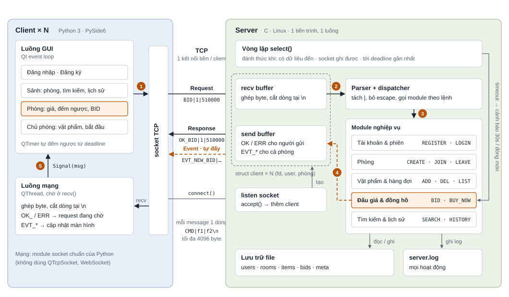

# Kiến trúc hệ thống Online Auction

Bản đề xuất ngày 18/10/2026, trình bày ở Checkpoint 1. Server viết bằng C trên Linux,
client viết bằng Python + PySide6. Hai bên nói chuyện qua giao thức OAP do nhóm tự thiết
kế trên TCP thô.

> Đây là tài liệu **giải thích**. Chi tiết chính thức nằm ở `PROTOCOL.md` (giao thức) và
> `DATA_MODEL.md` (dữ liệu, lưu trữ). Các khái niệm nền (socket, framing, `select()`,
> hai luồng ở client) được giải thích trong [`KIEN_THUC_NEN.md`](KIEN_THUC_NEN.md).

Mỗi client giữ một kết nối TCP với server suốt phiên làm việc. Server chạy một luồng duy
nhất, nên mọi trạng thái phòng chỉ do vòng `select()` xử lý lần lượt. Đường nét đứt màu
cam là chiều server tự đẩy event xuống client. Các số tròn đánh dấu một lượt trả giá, mô
tả ngay bên dưới.

---

## 1. Một lượt BID đi qua hệ thống

1. Người dùng bấm **Trả giá**. Luồng GUI gọi `sendall("BID|1|510000\n")` trên socket,
   nghĩa là trả 510.000 cho món số 1.
2. `select()` báo socket có dữ liệu. Server `recv()` vào recv buffer của client đó và cắt
   ra đúng một dòng tại `\n`.
3. Parser tách trường, dispatcher gọi module Đấu giá. Module kiểm tra món số 1 đúng là
   món đang đấu, giá ≥ giá hiện tại + 10.000 VND, và người trả không phải chủ phòng hay
   người đang giữ giá cao nhất. Nếu còn ≤ 30 giây thì đặt lại deadline = bây giờ + 30
   giây.
4. Module ghi `OK_BID` vào send buffer của người trả giá, và `EVT_NEW_BID` (kèm số giây
   còn lại) vào send buffer của mọi thành viên trong phòng. Phần nào `send()` chưa gửi hết
   thì vòng `select()` sau gửi tiếp.
5. Ở mỗi client, luồng mạng nhận dòng `EVT_NEW_BID` và phát Signal sang luồng GUI. Màn
   hình cập nhật giá mới, QTimer đếm lại theo số giây còn lại mới.

## 2. Vì sao thiết kế như vậy

| Quyết định | Lý do |
|---|---|
| **Server một luồng với `select()`** | Chỉ một luồng đụng vào dữ liệu phòng và vật phẩm, nên không cần mutex. Hai lượt BID đến cùng lúc vẫn được xử lý lần lượt, không ghi đè nhau. |
| **Đồng hồ nằm trong `select()`** | Timeout của `select()` bằng thời gian còn lại tới deadline gần nhất. Không cần luồng hẹn giờ riêng: cảnh báo 30 giây, gia hạn và đóng món đều chạy trong cùng vòng lặp. |
| **Client có luồng mạng riêng** | Server đẩy event bất cứ lúc nào, kể cả khi client đang chờ response. Nếu chỉ đọc socket sau mỗi lần gửi, client sẽ bỏ lỡ giá mới của người khác. |
| **Đếm ngược ở client** | Server chỉ gửi số giây còn lại, client tự đếm bằng QTimer. Server không phải gửi gói tin mỗi giây, và đồng hồ máy client có lệch cũng không ảnh hưởng. |

## 3. Khối nào của ai

Theo [`PHAN_CONG.md`](PHAN_CONG.md). File cụ thể xem bảng "Ai sửa file nào" trong `README.md`.

| Khối trong sơ đồ | Người phụ trách |
|---|---|
| Luồng GUI, luồng mạng (toàn bộ client) | Hòa |
| Vòng lặp `select()`, listen socket, recv/send buffer, parser + dispatcher | Huy |
| Tài khoản & phiên | Huy |
| Phòng | Minh |
| Vật phẩm (thêm, xóa, xem) | Hòa |
| Hàng đợi, đấu giá & đồng hồ | Minh |
| Tìm kiếm & lịch sử | Huy |
| Lưu trữ file, `server.log` | Huy |

## 4. Môi trường và công cụ

| Thành phần | Lựa chọn | Ghi chú |
|---|---|---|
| Server | C11, GCC, Make | Ubuntu 24.04, cờ `-std=c11 -Wall -Wextra -pedantic` |
| I/O server | Socket POSIX + `select()` | 1 tiến trình, 1 luồng |
| Client GUI | Python 3 + PySide6 | Qt Widgets, chạy trên Windows, Linux, macOS |
| Client mạng | Module `socket` + QThread | Không dùng QTcpSocket hay WebSocket, đúng yêu cầu raw socket của Lec00 |
| Giao thức | OAP v1.0.1 | Text UTF-8, trường ngăn bằng dấu `\|`, kết thúc bằng `\n`. Chi tiết trong `PROTOCOL.md` |
| Lưu trữ | File text | Đọc vào RAM khi server khởi động, ghi lại khi dữ liệu thay đổi. Chi tiết trong `DATA_MODEL.md` |
| Kiểm thử | `nc`, Wireshark / tshark | Test server bằng `nc` khi chưa có client, xem gói tin bằng tshark |

## 5. Còn để ngỏ

Hai câu hỏi dưới đây cũng ghi ở `PROTOCOL.md` mục 14, chờ hỏi thầy.

- **Băm mật khẩu:** nhóm chọn hàm `crypt()` có sẵn của hệ thống, kiểu SHA-512. Cần thầy
  xác nhận được phép dùng.
- **Tìm theo khung giờ:** đề bài yêu cầu tìm vật phẩm theo khung giờ. Có thể thêm giờ bắt
  đầu dự kiến cho mỗi phòng, hoặc tìm theo thời điểm món đã được đấu. Các cách hiểu khác
  xem `checkpoint1/tham-khao-repo-cu.md` mục 3.3.

---

*Đúng 4 yêu cầu bắt buộc trong Lec00: server C trên Linux, client tự chọn ngôn ngữ, giao
thức tự xây trên raw socket, không dùng proxy server.*
